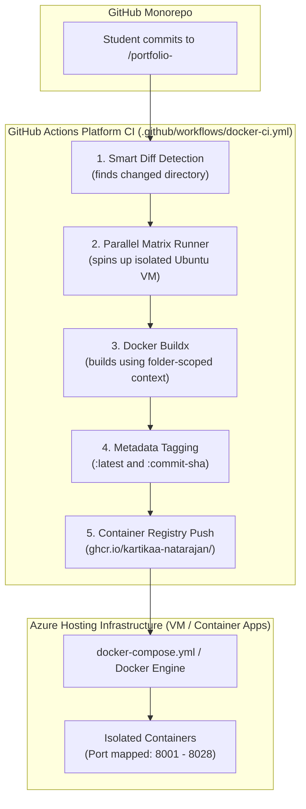

# Containerization & CI/CD Infrastructure Guide

This document describes the automated Docker containerization and GitHub Actions CI/CD infrastructure for the **Azure Cloud Portfolio Project**.

---

## 1. Architecture Overview

This infrastructure provides a turnkey, multi-tenant platform for all student portfolios in the monorepo:



---

## 2. Portfolio Isolation Strategy

Each portfolio lives in its own subdirectory and is isolated at two critical stages:

### A. Build-Time Isolation
* Every portfolio folder contains its own self-contained `Dockerfile` and `.dockerignore`.
* When Docker builds an image, the build context is scoped strictly to that student's folder:
  ```bash
  docker build -t portfolio-sakshi:latest ./portfolio-Sakshi
  ```
* Docker only accesses files within that folder. Dependencies, node_modules, and configuration files never leak or conflict across portfolios.

### B. Runtime & Port Isolation
* In production or local development, each container runs inside its own isolated Linux container network namespace.
* Each portfolio is mapped to a distinct host port in `docker-compose.yml`:

| Port | Service Name | Portfolio Directory | Tech Stack |
| :--- | :--- | :--- | :--- |
| **8001** | `portfolio-anshumaan` | `AnshumaanKhare-portfolio` | Vite + React (Nginx) |
| **8002** | `portfolio-abel-shon` | `portfolio-abel-shon` | Static HTML (Nginx) |
| **8005** | `portfolio-adrish` | `portfolio-adrish-chowdhury` | Vite + React (Nginx) |
| **8007** | `portfolio-devyansh` | `portfolio-devyansh` | Static HTML (Nginx) |
| **8010** | `portfolio-govind-madhav` | `portfolio-govind-madhav` | Next.js (Standalone) |
| **8013** | `portfolio-kalyani` | `portfolio-kalyani` | Vite + React (Nginx) |
| **8014** | `portfolio-kartikaa` | `portfolio-kartikaa` | Vite + React (Nginx) |
| **8016** | `portfolio-megha` | `portfolio-megha` | Vite + React (Nginx) |
| **8018** | `portfolio-prem` | `portfolio-prem` | Static HTML (Nginx) |
| **8019** | `portfolio-rohit` | `portfolio-rohit` | Node.js Express Server |
| **8021** | `portfolio-sakshi` | `portfolio-Sakshi` | Vite + React (Nginx) |
| **8023** | `portfolio-simran` | `portfolio-simran` | Node.js Express Server |
| **8024** | `portfolio-smrithi` | `portfolio-smrithi` | Python Flask + Gunicorn |
| **8027** | `portfolio-utkarsh` | `portfolio-utkarsh` | Next.js Export (Nginx) |

---

## 3. Standard Dockerfile Templates Used

### 1. Vite / React (Multi-Stage Alpine Build)
Used by: `portfolio-Sakshi`, `portfolio-kalyani`, `portfolio-kartikaa`, `portfolio-megha`, `AnshumaanKhare-portfolio`, `portfolio-adrish-chowdhury`.
```dockerfile
# Stage 1: Build static assets
FROM node:20-alpine AS build
WORKDIR /app
COPY package*.json ./
RUN npm ci
COPY . .
RUN npm run build

# Stage 2: Serve using Nginx
FROM nginx:alpine
COPY --from=build /app/dist /usr/share/nginx/html
EXPOSE 80
CMD ["nginx", "-g", "daemon off;"]
```

### 2. Static HTML / CSS / JS
Used by: `portfolio-abel-shon`, `portfolio-abhishek-kumar`, `portfolio-adithya-tej-bm`, `portfolio-devyansh`, `portfolio-jeeva`, `portfolio-manish-yadav`, `portfolio-prajwal`, `portfolio-prem`, `portfolio-rubika`, `portfolio-shivam`, `portfolio-Sourav`, `portfolio-anusha`.
```dockerfile
FROM nginx:alpine
COPY . /usr/share/nginx/html
EXPOSE 80
CMD ["nginx", "-g", "daemon off;"]
```

### 3. Python Flask + Gunicorn
Used by: `portfolio-smrithi`.
```dockerfile
FROM python:3.11-slim
WORKDIR /app
COPY requirements.txt .
RUN pip install --no-cache-dir -r requirements.txt
COPY . .
EXPOSE 5000
CMD ["gunicorn", "--bind", "0.0.0.0:5000", "app:app"]
```

### 4. Node.js Express Backends
Used by: `portfolio-rohit`, `portfolio-simran`.
```dockerfile
FROM node:20-alpine
WORKDIR /app
COPY package*.json ./
RUN npm ci --omit=dev
COPY . .
ENV PORT=8080
EXPOSE 8080
CMD ["node", "server.js"]
```

---

## 4. How the GitHub Actions CI Pipeline Works

The workflow file is located at **`.github/workflows/docker-ci.yml`**.

### Key Pipeline Behaviors:
1. **Pull Request Validation (`pull_request`)**:
   - Compares the PR branch against `main` using `git diff`.
   - Identifies which portfolio directories were modified.
   - Runs `docker build` using Buildx to ensure the container compiles cleanly with zero errors.
   - `push: false` during PRs (validates without publishing).
2. **Production Registry Push (`push` to `main`)**:
   - Triggers automatically when a PR is merged into `main`.
   - Logs into GitHub Container Registry (`ghcr.io`) using `GITHUB_TOKEN`.
   - Tags the image:
     - `ghcr.io/<owner>/<portfolio>:latest`
     - `ghcr.io/<owner>/<portfolio>:<git-sha>`
   - Pushes the image to GHCR.
3. **Manual Trigger (`workflow_dispatch`)**:
   - You can trigger builds manually from the GitHub Actions tab.
   - Input option allows building a specific portfolio (e.g. `portfolio-Sakshi`) or `all`.

---

## 5. Running Portfolios with Docker Compose & Reverse Proxy

The project includes an intelligent **Nginx Reverse Proxy & Dashboard** ([proxy/](file:///d:/Govind/azure-cloud-portfolio-project/proxy)) that routes requests by subdomain and provides a central landing page.

### How URLs Work:

| Environment | Example URL | Notes |
| :--- | :--- | :--- |
| **Localhost** | `http://sakshi.localhost:8080/` | `*.localhost` automatically resolves to `127.0.0.1` in all modern browsers. |
| **VM with Public IP** | `http://sakshi.<VM-IP>.nip.io:8080/` | Uses `nip.io` wildcard DNS (zero setup needed). |
| **Custom Domain** | `http://sakshi.yourdomain.com/` | Add wildcard DNS `*.yourdomain.com -> <VM IP>`. |
| **Landing Dashboard** | `http://localhost:8080/` | Visual search dashboard listing all 28 portfolios. |

---

### Commands:

```bash
# Start the proxy and Sakshi's portfolio:
docker compose up -d proxy sakshi-portfolio

# Start all portfolios and the proxy:
docker compose up -d

# Check running status:
docker compose ps

# Stop containers:
docker compose down
```

---

## 6. Automated Portfolio Provisioning Script

Whenever a new student adds their portfolio to the repository, you don't have to manually configure Docker or update Nginx proxy files. Run the turnkey automation script:

```bash
python scripts/generate_docker_setup.py
```

### What the Script Automatically Does:
1. **Scans the repository** for any new portfolio directories.
2. **Inspects the tech stack** (`package.json`, Vite, Next.js, Express, Flask `requirements.txt`, or Static HTML).
3. **Generates the Dockerfile & `.dockerignore`** matching that specific stack (if not already present).
4. **Updates `proxy/nginx.conf`** with the new subdomain upstream routing.
5. **Updates `proxy/index.html`** with the new student's card, formatted name, and tech stack badge.

---

## 7. Guide for Future Contributors / Students

When a new student adds their portfolio:
1. Create a folder `portfolio-<your-name>/`.
2. Add your application files inside.
3. Either run `python scripts/generate_docker_setup.py` or let the automated platform CI detect it.
4. Submit your Pull Request targeting `main`.
5. The platform CI will automatically detect your folder, test your Docker build, and report the status check on your PR.
